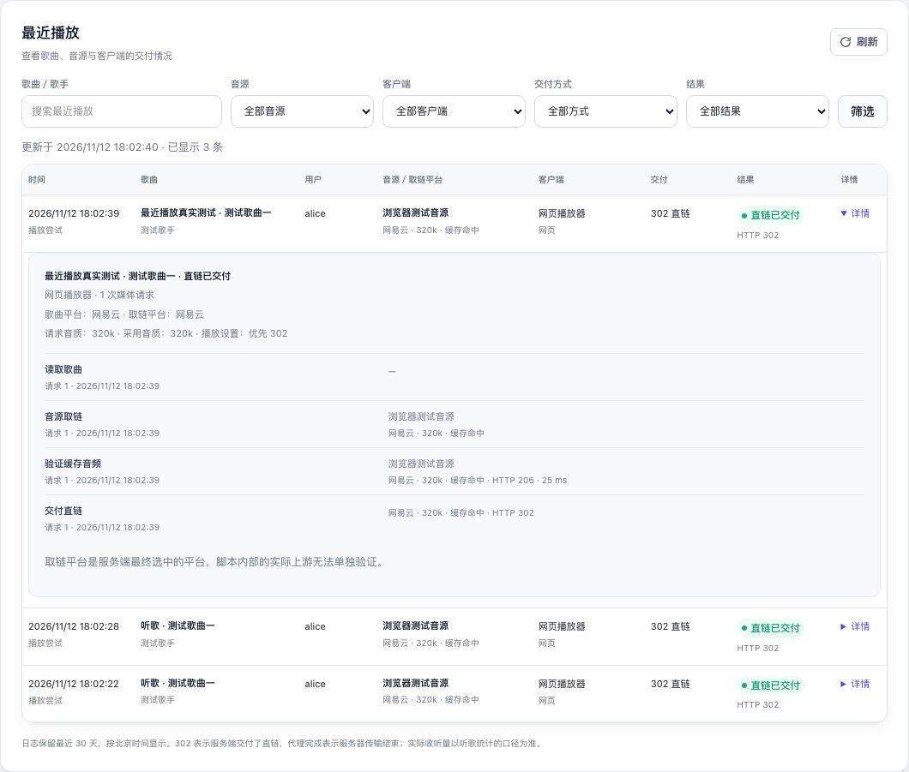

# 最近播放日志、飞牛估算与音源调度恢复验收

验收日期：2026-11-12。按用户已确认的 Q1–Q13 实现，设计见 [recent-playback-design.md](recent-playback-design.md)，统计边界与调度恢复取舍见 [ADR 0003](adr/0003-playback-delivery-listening-boundary.md) 和 [ADR 0004](adr/0004-source-schedule-persistence.md)。

本次最终回归针对当前完整工作树，其中包含此前飞牛歌单写入、收藏和下载的未提交改动。最近播放功能的后端专项测试与前端验收单独覆盖以下行为。

## 已验收行为

| 项目 | 已验证结果 |
| --- | --- |
| 展示与交互 | 最近播放位于听歌统计汇总卡片下方，显示时间、歌曲与歌手、用户、音源脚本、取链平台、客户端、音质、交付方式与结果。默认倒序 50 条，支持加载更多、筛选和详情；汇总刷新保留未提交输入、已加载旧页和展开详情。 |
| 交付事实 | 实际网页 302 与代理链路通过。取链失败不伪造交付方式，自动降质共用同一播放日志；长代理传输可查看已选音源，结束后记录完成或中断。Subsonic 协议错误保留实际 HTTP 状态。 |
| 跨平台来源 | 服务端跨平台兜底的胜出平台、曲目和音源进入日志，并反馈到正确平台的调度状态。详情说明取链平台的可观测范围，不把脚本内部的实际上游视为已验证来源。 |
| 播放关联 | 网页自动重试沿用播放标识，主动重播和单曲循环创建新标识。飞牛先取流后上报可以关联同一条日志；较晚的同曲完整取流先单独记录，随后重播事件关联新播放。Range 不额外累计收听。 |
| 飞牛估算 | 同一用户、登录会话和曲目的固定 5 秒去重窗不被重复事件延长；切换其他歌曲后再播重新计次，不同用户和会话分别累计。已知时长计入客户端估算，缺少时长仅计次数；页面说明快速切歌可能高估和秒内重播可能被合并。 |
| 权限与数据 | 列表、详情和筛选选项按同一用户范围隔离；普通用户不能查询其他用户或全站。退出换号取消旧请求，迟到的列表和详情不能显示原账号数据。日志不保存认证值或媒体地址，接口响应不包含内部播放关联标识。 |
| 留存与恢复 | 30 天外的日志清理后，其明细级联删除，累计听歌统计保持原值；每条日志保留最新 100 条明细和明细总数。SQLite 快照恢复保留日志与统计。启动时旧进程尚未结束的传输改为“结束结果未确认”，不补算收听。 |
| 音源调度 | 重启恢复仍有效的样本、连续失败和原冷却／限流截止时间，不重新续期；10 分钟无新样本后清除陈旧惩罚。同内容停用、启用和重载保留经验，脚本变更重置，旧脚本迟到反馈被拒绝；删除音源后清理持久状态，快照恢复保留有效经验，重启释放旧探测锁。 |

调度持久化已接入完整备份前和退出时的补写流程。正常运行时后台保存，写入失败保留待写状态并重试。调度恢复的专项测试直接核对 SQLite 快照内的原始样本与恢复后的排序、截止时间。

## 最终检查

| 检查 | 结果 |
| --- | --- |
| `GOTOOLCHAIN=go1.27.0 bash scripts/check.sh --race` | 全部源码包 Go 竞态测试、`go vet`、脚本语法与差异检查通过；84 项 Node 测试全部通过。 |
| `GOTOOLCHAIN=go1.27.0 node tests/web/browser.cjs` | 最终源码重新构建隔离服务，97 项 Chromium 验收全部通过，其中最近播放新增 13 项。 |
| `GOTOOLCHAIN=go1.27.0 node scripts/licenses.mjs --check` | 许可清单已更新并校验通过：21 个 Go 模块、Go 1.27.0 标准库、3 个 bundle 包及 esbuild，75 份原文／源码副本。 |
| `GOTOOLCHAIN=go1.27.0 go build -o … ./cmd/lxsc` | 最终程序构建通过，验收二进制保存在本轮临时目录中。 |

浏览器覆盖桌面 1440×1080、平板 820×1180、手机 390×844 和窄屏 320×740 的浅色／深色布局。表格与手机卡片均无页面横向溢出；恶意 HTML 样例按普通文本展示，没有插入图片或执行事件。

最终浏览器结果及全部截图位于 `/private/tmp/lxsc-recent-playback.aamikp/browser-final/`，构建产物为 `/private/tmp/lxsc-recent-playback.aamikp/lxsc-final`。验收使用独立 Go 缓存、临时 SQLite、合成 WAV、测试音源和隔离账号，不使用运行服务的数据库或外部音乐平台。

## 展示图

以下截图复制自最终浏览器验收。302 展示来自真实隔离接口与合成音频；多行布局使用明确的测试示例数据，其中字面量 HTML 歌名用于验证转义。

- [桌面浅色列表与展开详情](images/recent-playback-20261112/desktop-light.png)
- [手机深色卡片与展开详情](images/recent-playback-20261112/mobile-dark.png)

## 验收范围

飞牛开始事件与媒体关联通过隔离 HTTP 协议调用验证，本次没有进行原版官方 App 的现场复验。302 只确认服务端交付直链，代理传输完成只确认服务端传输结束；飞牛累计量按已确认的客户端估算口径计算。

本轮未提交、推送或部署。静态资源嵌入二进制，运行服务需要使用重新构建后的程序才能显示新功能。
